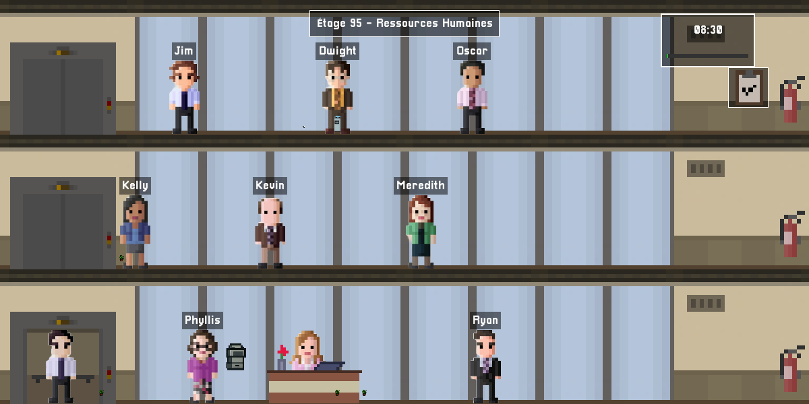

# Office Day

**🥉 3rd place, best game jury prize at the ESIEE 72-hour Game Jam (2025)**

A narrative pixel-art game made in Python and Pygame by a team of four students.



> **Content note:** the game is set on the upper floors of the World Trade Center on the morning of September 11, 2001. The game contains no graphic depiction of the events. It shows an ordinary working morning and ends at 08:48.

## About the game

You play an office employee starting an ordinary workday. The clock starts at 08:30. You take the elevator between floors, talk to colleagues, help them with small everyday tasks and complete the boss's requests. The game deliberately focuses on these small, ordinary moments.

When the clock reaches its deadline, the screen shakes and fades to black. An end-of-day summary then lists what you accomplished and the trophies you earned.

The game is short (about 5 minutes of real time for 18 in-game minutes), so players can replay it to try different choices.

## Features

- **Five office floors (95 to 99).** Human Resources, Marketing, IT, Finance and Management, connected by an elevator. Each floor has its own colleagues and objects to interact with.
- **20 tasks.** 7 main tasks form a chain of requests from the boss, and 13 optional side tasks include watering a plant, fixing the printer and bringing coffee to a colleague.
- **Branching dialogue.** Conversations use a node graph with conditions and effects: a dialogue can set story flags and offer or reveal tasks.
- **A real-time clock.** The clock drives a timeline of scripted events, such as the printer problem getting worse if you leave it and colleagues' conversations, as well as random interruptions like phone calls and urgent emails.
- **A living office.** Colleagues walk around and chat in speech bubbles, and ambient office sounds play in the background.
- **15 trophies and an end-of-day summary.** Trophies range from common to legendary, for example *Explorer*, *Elevator Master* and *Last Minute*.

## Technical highlights

The game runs on a small engine the team wrote on top of Pygame:

| Area | Implementation |
|---|---|
| Architecture | Scene manager (content warning, menu, gameplay, pause, summary) and a publish/subscribe **event bus** that keeps game systems independent of each other |
| Data-driven content | Floors, tasks, dialogue graphs, trophies, the event timeline and all text are **JSON files**, so designers can change content without touching code |
| Asset pipeline | An asset manifest with automatic discovery and **placeholder fallbacks**, so a missing sprite never crashes the game |
| Game systems | A game clock, timeline controller, interruption manager, smooth camera, NPC movement, elevator state machine, and a task and trophy system |
| Audio | Audio manager with music, sound effects and randomized ambient sounds |
| Quality | Unit and integration tests with **pytest** |

## Controls

| Action | Keys |
|---|---|
| Move | `←` `→` or `A` `D` |
| Interact / talk | `E`, `Space` or `Enter` |
| Use the elevator | `↑` `↓` |
| Pause | `Esc` or `P` |

The in-game text is in French.

## Getting started

Requires **Python 3.12** (Pygame 2.6.1 supports Python up to 3.13).

```bash
git clone https://github.com/ldebuchy/office-day.git
cd office-day
python -m venv .venv
.venv\Scripts\activate          # Windows
source .venv/bin/activate       # macOS / Linux
pip install -r requirements.txt
python main.py
```

Run the tests:

```bash
python -m pytest
```

## Project structure

```
main.py          Entry point
src/
  core/          Engine: game loop, scenes, event bus, assets, audio, input, camera, clock
  scenes/        Content warning, menu, gameplay, pause, end-of-day summary
  world/         Building, elevator, NPCs, tasks, triggers
  ui/            HUD, dialogue box, speech bubbles, widgets
  data/          JSON content: floors, tasks, dialogue, trophies, timeline, text
assets/          Sprites, backgrounds, music, sound effects, font
tools/           Asset checker, sprite and interaction testers, pixel-art upscaler
tests/           pytest suite
docs/            Asset and sprite guides
```

## Credits

- Created by a team of four students at ESIEE during a 72-hour game jam (2025).
- Music: *Lobby Time* by Kevin MacLeod, licensed under [CC BY 4.0](https://creativecommons.org/licenses/by/4.0/).
- Font: *Pixellari* by Zacchary Dempsey-Plante.
- AI tools were used during development.
